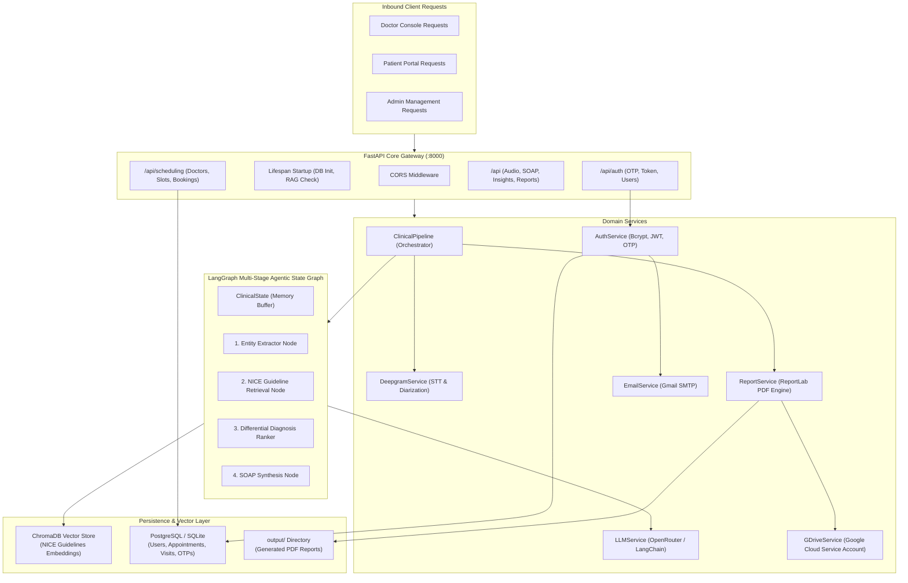
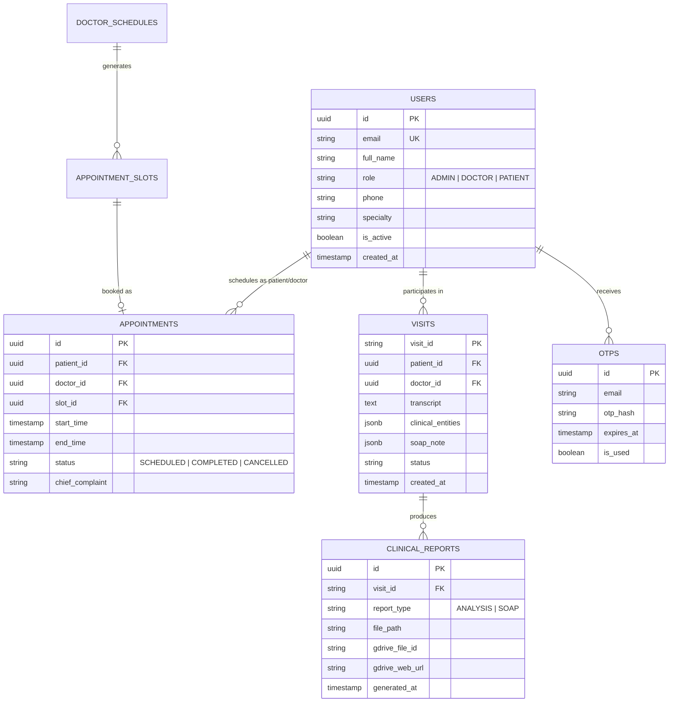

# Backend Architecture Document
## ClinIQ: Backend Clinical Intelligence & Agentic Architecture

---

## 1. System Architecture Overview

The ClinIQ Backend is built as an asynchronous FastAPI application organized into clean domain layers: **API Controllers**, **LangGraph Workflow Graph**, **Domain Services**, **RAG Vector Subsystem**, and **Database Repositories**.



---

## 2. LangGraph Clinical Decision Support Pipeline

The clinical decision engine is modeled as a stateful computational graph using `langgraph.graph.StateGraph`.


### 2.1 Graph State Definition (`ClinicalState`)
```python
class ClinicalState(TypedDict):
    visit_id: str
    patient_id: Optional[str]
    doctor_id: Optional[str]
    raw_transcript: str
    diarized_utterances: List[Dict[str, Any]]
    clinical_entities: Dict[str, Any]
    retrieved_guidelines: List[Dict[str, Any]]
    differential_diagnoses: List[Dict[str, Any]]
    red_flags: List[str]
    suggested_questions: List[str]
    soap_note: Dict[str, str]
    created_at: str
```

### 2.2 5-Tab Symmetrical Output Mapping
The pipeline normalizes LLM, RAG, and fallback outputs into 5 distinct CDS tab models emitted at both root level and within `clinical_analysis`:
1. **Differential Diagnosis:** Array of hypotheses with `rank`, `title`, `icdCode`, `percentage`, `risk`, `color`, `description`.
2. **Confidence Metrics:** `overallScore`, `overallLevel`, `subtext`, and 5-domain breakdown (`Symptom completeness`, `Medical history coverage`, `Lifestyle & social history`, `DDx alignment`, `Guideline adherence`).
3. **Follow-up Protocol Inquiries:** Array of inquiries with `id`, `question`, `priority`, `asked`, `answered`, `doctor_snippet`, `patient_snippet`.
4. **Guideline Medicines:** Evidence-graded medications with `name`, `drugClass`, `grade`, `source`, `dosage`, `recommendation`, `warning`.
5. **SOAP Report:** Complete structured narrative (`subjective`, `objective`, `assessment`, `plan`).

---

## 3. Database Architecture & ER Diagram

The backend utilizes SQLAlchemy ORM with support for dual database dialects: **PostgreSQL** in production environments and **SQLite** (`cliniq_local.db`) for seamless zero-setup local development.



---

## 4. Report Generation & Google Drive Integration Architecture

1. **ReportLab Canvas Engine:** Dynamically renders PDF documents applying standard clinical typography, grid layouts, tables, and colored status headers.
2. **Drive API Synchronization:**
   * Uses Google Cloud Service Account JSON credentials (`service_account.json`).
   * Authenticates via `google.oauth2.service_account.Credentials`.
   * Creates a dedicated `ClinIQ_Reports` folder on the Google Drive if not already present.
   * Uploads the PDF stream with MIME type `application/pdf`.
   * Sets permission `reader` for public preview or specified doctor/patient email.

---

## 5. Session Persistence & Symmetrical Serialization Architecture

* **Encounter Model (`PatientConsultationSession`):** Persists `conversation_json`, `ai_suggestions_json`, `clinical_analysis_json`, and `soap_report_json`.
* **Symmetrical Serialization:**
  * Endpoints `/api/scheduling/patients/{patient_id}/sessions` and `/api/v1/patients/{patient_id}/sessions` emit both camelCase (`aiSuggestions`) and snake_case (`ai_suggestions`).
  * Deserialization gracefully falls back to extract nested suggestions from `clinical_analysis_json` if `ai_suggestions_json` is unpopulated, preventing empty state degradation.

---

## 6. Triage Vitals Baseline & Dynamic Entity Extraction Pipeline

* **Triage Vitals Defaulting:** In `format_patient_dict` (`app/api/scheduling.py`), patient vitals are seeded with standard adult baseline parameters (`bp: 120/80 mmHg, hr: 72 bpm, spo2: 98%, temp: 36.6 °C`), updated with parsed values from `vitals_json` if present. This guarantees client applications never receive empty dictionary objects `{}`.
* **Smart Dialogue Entity Fallback:** `PipelineService._fallback_entities` inspects spoken conversation turns using targeted regex and keyword pattern matching to capture fatigue, polydipsia, polyuria, chest discomfort, blood pressure, heart rate, and finger-prick blood sugar/glucose metrics when upstream LLM extraction is unavailable.


