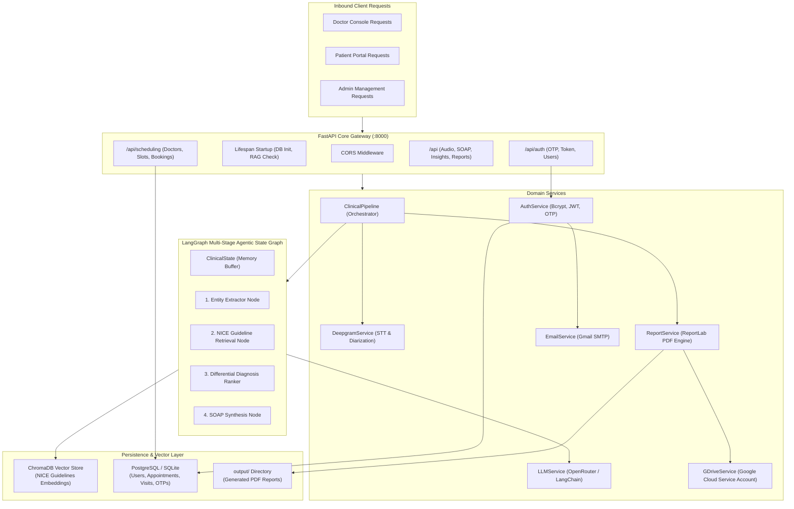
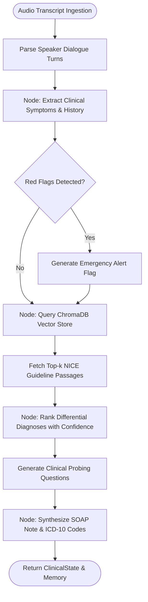
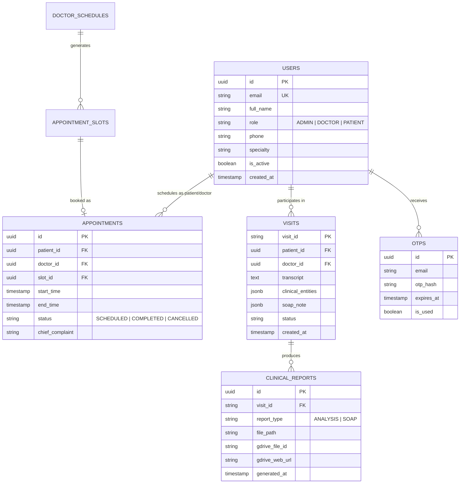

# Backend Architecture Document
## ClinIQ: Backend Clinical Intelligence & Agentic Architecture

---

## 1. System Architecture Overview

The ClinIQ Backend is built as an asynchronous FastAPI application organized into clean domain layers: **API Controllers**, **LangGraph Workflow Graph**, **Domain Services**, **RAG Vector Subsystem**, and **Database Repositories**.



---

## 2. LangGraph Clinical Decision Support Pipeline

The clinical decision engine is modeled as a stateful computational graph using `langgraph.graph.StateGraph`.



### 2.1 Graph State Definition (`ClinicalState`)
```python
class ClinicalState(TypedDict):
    visit_id: str
    patient_id: Optional[str]
    doctor_id: Optional[str]
    raw_transcript: str
    diarized_utterances: List[Dict[str, Any]]
    clinical_entities: Dict[str, Any]
    retrieved_guidelines: List[Dict[str, Any]]
    differential_diagnoses: List[Dict[str, Any]]
    red_flags: List[str]
    suggested_questions: List[str]
    soap_note: Dict[str, str]
    created_at: str
```

### 2.2 5-Tab Symmetrical Output Mapping
The pipeline normalizes LLM, RAG, and fallback outputs into 5 distinct CDS tab models emitted at both root level and within `clinical_analysis`:
1. **Differential Diagnosis:** Array of hypotheses with `rank`, `title`, `icdCode`, `percentage`, `risk`, `color`, `description`.
2. **Confidence Metrics:** `overallScore`, `overallLevel`, `subtext`, and 5-domain breakdown (`Symptom completeness`, `Medical history coverage`, `Lifestyle & social history`, `DDx alignment`, `Guideline adherence`).
3. **Follow-up Protocol Inquiries:** Array of inquiries with `id`, `question`, `priority`, `asked`, `answered`, `doctor_snippet`, `patient_snippet`.
4. **Guideline Medicines:** Evidence-graded medications with `name`, `drugClass`, `grade`, `source`, `dosage`, `recommendation`, `warning`.
5. **SOAP Report:** Complete structured narrative (`subjective`, `objective`, `assessment`, `plan`).

---

## 3. Database Architecture & ER Diagram

The backend utilizes SQLAlchemy ORM with support for dual database dialects: **PostgreSQL** in production environments and **SQLite** (`cliniq_local.db`) for seamless zero-setup local development.



---

## 4. Report Generation & Google Drive Integration Architecture

1. **ReportLab Canvas Engine:** Dynamically renders PDF documents applying standard clinical typography, grid layouts, tables, and colored status headers.
2. **Drive API Synchronization:**
   * Uses Google Cloud Service Account JSON credentials (`service_account.json`).
   * Authenticates via `google.oauth2.service_account.Credentials`.
   * Creates a dedicated `ClinIQ_Reports` folder on the Google Drive if not already present.
   * Uploads the PDF stream with MIME type `application/pdf`.
   * Sets permission `reader` for public preview or specified doctor/patient email.

---

## 5. Session Persistence & Symmetrical Serialization Architecture

* **Encounter Model (`PatientConsultationSession`):** Persists `conversation_json`, `ai_suggestions_json`, `clinical_analysis_json`, and `soap_report_json`.
* **Symmetrical Serialization:**
  * Endpoints `/api/scheduling/patients/{patient_id}/sessions` and `/api/v1/patients/{patient_id}/sessions` emit both camelCase (`aiSuggestions`) and snake_case (`ai_suggestions`).
  * Deserialization gracefully falls back to extract nested suggestions from `clinical_analysis_json` if `ai_suggestions_json` is unpopulated, preventing empty state degradation.

---

## 6. Triage Vitals Baseline & Dynamic Entity Extraction Pipeline

* **Triage Vitals Defaulting:** In `format_patient_dict` (`app/api/scheduling.py`), patient vitals are seeded with standard adult baseline parameters (`bp: 120/80 mmHg, hr: 72 bpm, spo2: 98%, temp: 36.6 °C`), updated with parsed values from `vitals_json` if present. This guarantees client applications never receive empty dictionary objects `{}`.
* **Smart Dialogue Entity Fallback:** `PipelineService._fallback_entities` inspects spoken conversation turns using targeted regex and keyword pattern matching to capture fatigue, polydipsia, polyuria, chest discomfort, blood pressure, heart rate, and finger-prick blood sugar/glucose metrics when upstream LLM extraction is unavailable.

---

## 7. Production Containerization & Cloudflare Zero Trust Ingress

* **Docker Compose Orchestration (`docker-compose.prod.yml`):**
  * `postgres`: PostgreSQL 16 Alpine container with isolated healthchecks (`pg_isready`) and volume persistence (`cliniIQ` database).
  * `redis`: Redis 7 Alpine in-memory cache for hybrid RAG retrieval queries.
  * `backend`: Python 3.11 Slim container running FastAPI/Uvicorn with 2 worker processes and persistent volumes.
  * `frontend`: Angular 19 + Nginx 1.25 Alpine container serving the SPA on port 80 and reverse-proxying API traffic.
* **Target Server Environment (`ubtsrv01`):**
  * **Host IP:** `172.16.17.181` (Ubuntu 24.04.5 LTS, Kernel 6.8.0-147-generic).
  * **Network Security:** Cloudflare Zero Trust organization `cbtlab` (`cbtlab.cloudflareaccess.com`).
  * **Client Interface IP:** `10.64.20.180` (WARP client tunnel).

---

## 8. Doctor Queue Seed Synchronization & Database Connection Dialect Normalization
* **Database Driver Normalization:** In SQLAlchemy 2.0+, standard `postgresql://` connection strings default to `psycopg` (v3). `app/core/database.py` incorporates `get_normalized_db_url()` which rewrites `postgresql://` and `postgres://` to `postgresql+psycopg2://` before passing to `create_engine()`, ensuring seamless connection to PostgreSQL 16 using `psycopg2-binary`.
* **Specialist Seed Synchronization:** `ensure_initial_seed_data(db)` in `app/api/scheduling.py` ensures that newly provisioned clinicians (such as Dr. Ankit Kumar `DOC-008`, Cardiology) receive booked slots and patient assignments (`Marcus Delgado`, `Arjun Nair`, `Priya Sharma`). It detects existing databases where `DOC-008` has 0 assigned patients and automatically re-assigns triage and department-matching patients to guarantee continuous clinic workflow.
* **Intelligent Queue Fallback:** In `/api/scheduling/queue/{doctor_id_or_name}`, if direct doctor ID lookups return empty arrays, the service falls back to query unassigned triage patients (`arrival_status == 'ARRIVED'`) and department-matching patients (e.g., Cardiology), ensuring the clinical queue is never blank.

  * **Telemetry Endpoint:** `GET http://172.16.17.181/health` (verified HTTP 200 OK with live database ping).
  * **API Docs:** `GET http://172.16.17.181/docs` (Swagger UI).
  * **Automated Verification:** 6/6 tests passing (100% success rate across health, telemetry, doctors, and user routes).

---

## 8. Configuration Architecture & Dialect Normalization

* **Central Configuration Hub (`app/core/config.py`):**
  * `load_settings() -> dict[str, Any]`: Loads root `.env` and application `.env` files with priority overriding. Returns an explicitly typed dictionary contract to prevent static type checkers (Pyright/Pylance) from inferring fragile heterogeneous unions (`dict[str, Union[str, int]]`).
* **Database Driver Dialect Normalization (`app/db/session.py`):**
  * `get_database_url() -> str`: Inspects `DATABASE_URL` or builds connection strings from discrete environment variables (`DB_USER`, `DB_PASSWORD`, `DB_HOST`, `DB_PORT`, `DB_NAME`).
  * Normalizes standard `postgresql://` URI schemes to explicit SQLAlchemy Psycopg2 driver schemes (`postgresql+psycopg2://`), ensuring compatibility with SQLAlchemy 2.0+ and avoiding legacy psycopg driver resolution errors.
  * Sanitizes all parsed connection components via defensive string wrapping (`str(settings.get(...) or "").strip()`), preventing type errors and runtime attribute mismatches.

---

## 9. Relational Persistence Architecture, Host Port Exposure & Dual-Trigger SOAP Synchronization

* **PostgreSQL Ingress & Port Exposure (`docker-compose.prod.yml`):**
  * `cliniq-postgres-prod` publishes container port `5432` to the host (`5432:5432`), enabling direct relational access from external database administration clients (pgAdmin 4, DBeaver, automated telemetry scripts) across Cloudflare Zero Trust / LAN.
  * Multi-Database Coexistence: The PostgreSQL 16 Alpine container maintains both the primary production database `cliniIQ` and a migration/mirror database `cliniq_db` to support legacy queries and zero-downtime historical synchronizations.
* **Bi-directional Doctor Entity Synchronization (`DoctorModel` & `User`):**
  * Clinician profiles registered via OTP (`role == "DOCTOR"`) or provisioned via administration routes automatically synchronize with both the `users` table and the dedicated `doctors` (`DoctorModel`) relational table.
  * Lifecycle operations (`register_new_doctor`, `update_doctor`, `toggle_doctor_duty`, and `delete_doctor` in `app/api/scheduling.py`) perform atomic dual writes to ensure foreign key integrity for `DoctorSlot` and clinical queue rosters.
* **Dual-Trigger SOAP Feedback Persistence (`soap_feedback`):**
  * Both consultation completion (`/api/scheduling/patients/{patient_id}/complete-consultation`) and SOAP sharing (`/api/scheduling/patients/{patient_id}/share-soap`) automatically persist or update the structured SOAP note in the `soap_feedback` table.
  * Clinical consultation sessions containing a `soap_report` or `soap_report_json` populate `soap_feedback` with `is_finalized = True`, capturing physician adjustments, original RAG output, and timestamped audit logs for continuous learning.


