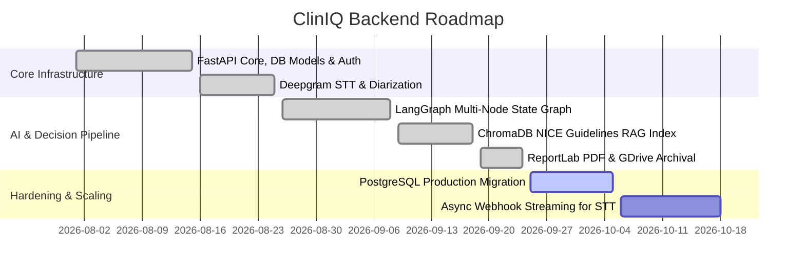

# Backend Tasks & Development Roadmap
## ClinIQ: Backend Clinical Intelligence Tasks

---

## 1. Development Milestones

---

## 2. Detailed Task Breakdown

### 2.1 Completed Tasks (Done)
- [x] **TSK-BE-01:** Scaffold FastAPI microservice with lifespan event handling (`app/main.py`).
- [x] **TSK-BE-02:** Implement SQLAlchemy ORM models with dual PostgreSQL / SQLite engine support (`app/core/database.py`).
- [x] **TSK-BE-03:** Build Gmail SMTP OTP generation, hashing, and verification service (`app/services/auth_service.py`, `app/services/email_service.py`).
- [x] **TSK-BE-04:** Integrate Deepgram Nova-2 Medical Speech-to-Text with speaker diarization mapping (`app/services/deepgram_service.py`).
- [x] **TSK-BE-05:** Implement LangGraph stateful clinical decision graph (`app/graph/clinical_graph.py`).
- [x] **TSK-BE-06:** Implement ChromaDB vector store ingestion and retrieval service over NICE clinical guidelines (`app/rag/`).
- [x] **TSK-BE-07:** Implement ReportLab PDF clinical report engine generating Clinical Analysis and SOAP note PDFs (`app/services/report_service.py`).
- [x] **TSK-BE-08:** Integrate Google Drive API via Service Account for automated cloud archival (`app/services/gdrive_service.py`).
- [x] **TSK-BE-09:** Build appointment scheduling endpoints with doctor slot management and booking validations (`app/api/scheduling.py`).
- [x] **TSK-BE-10:** Configure LangSmith tracing integration for LLM telemetry and observability (`app/core/tracing.py`).
- [x] **TSK-BE-11:** Implement Dynamic Condition-Adaptive Clinical Follow-Up Question Extraction in `PipelineService` with LLM schema parsing and fallback generators.
- [x] **TSK-BE-12:** Multi-Appointment Sequential Session Lifecycle & Flexible Patient ID Lookups: implemented `/api/scheduling/patients/{patient_id}/sessions` and `/api/v1/patients/{patient_id}/sessions` supporting sequential numbering (Session 1 -> Close Consultation -> Session 2 -> Session N+1) and flexible PID format resolution (`#00847261` vs `00847261`).
- [x] **TSK-BE-13:** Clinical Speaker Diarization & Role Disambiguation: Enhanced `ConversationService` with split-turn extraction, complementary physician-patient role enforcement, turn-by-turn intent refinement, and consecutive utterance merging.
- [x] **TSK-BE-14:** Document-routed Hybrid RAG: Implemented BM25 sparse + FAISS dense retrieval with Reciprocal Rank Fusion (RRF) over expanded NICE guideline catalog (`app/rag/bm25.py`, `app/rag/guideline_catalog.py`, `app/rag/retrieval_service.py`).
- [x] **TSK-BE-15:** Confidence-Based Follow-up Loop: Added one-round follow-up workflow (`app/services/followup_service.py`, `POST /visit/{visit_id}/follow-up`) triggered when diagnosis confidence < 0.70.
- [x] **TSK-BE-16:** Institutional Visit Persistence & S3 Cloud Storage: Implemented PostgreSQL schema `cliniIQ` persistence via SQLAlchemy (`app/db/visit_store.py`) and S3 PDF uploads (`app/storage/s3_service.py`).
- [x] **TSK-BE-17:** RAGAS Validation Framework: Added quantitative RAG quality benchmarking (`app/services/ragas_service.py`, `POST /visit/{visit_id}/ragas`).
- [x] **TSK-BE-18:** DevOps, Containerization & CI/CD: Added multi-stage `Dockerfile`, `docker-compose.yml`, smoke test scripts, and GitHub Actions CI / ECR deploy workflows.
- [x] **TSK-BE-22:** Physician Prescription Directives Persistence & Patient Portal Share Endpoint: Enhanced `ShareSoapReportSchema` and `POST /api/scheduling/patients/{patient_id}/share-soap` to accept doctor's custom prescription directives and patient names, embed them inside `soap_report_json`, and dynamically extract structured prescription models in `_extract_prescriptions_from_soap` for seamless patient portal retrieval.
- [x] **TSK-BE-23:** Symmetrical Dual-Key AI Suggestions Serialization in Session Endpoints: Updated `/api/scheduling/patients/{patient_id}/sessions` and `/api/v1/patients/{patient_id}/sessions` to emit both `ai_suggestions` and `aiSuggestions`, with fallback resolution from `clinical_analysis_json`.
- [x] **TSK-BE-24:** Baseline Triage Vitals Defaults & Smart Entity Fallback Extraction: Updated `format_patient_dict` to initialize standard triage vitals (`bp: 120/80 mmHg, hr: 72 bpm, spo2: 98%, temp: 36.6 °C`) preventing empty `{}` emission, and enhanced `_fallback_entities` in `PipelineService` to automatically extract symptoms (fatigue, polydipsia, polyuria, headache, etc.) and vitals (blood pressure, pulse, elevated blood glucose) from conversation text.
- [x] **TSK-BE-25:** Dynamic 5-Tab CDS Pipeline & Symmetrical Tab Serialization: Synchronized `app/api/routes.py`, `app/services/pipeline_service.py`, and `app/schemas/schemas.py` to ensure all 5 Clinical Decision Support tabs (`differential_diagnosis`, `guideline_medicines`, `red_flags`, `confidence_metrics`, `follow_up_questions`, `soap_report`) are computed dynamically across all audio upload modes (MS Teams, Google Meet, WhatsApp, In-Person) with condition-aware ICD-10 differentials, RAG medications, 5-domain confidence breakdowns, and doctor/patient consultation metadata forwarding.
- [x] **TSK-BE-26:** Strict Type-Safe Diagnosis Confidence & Follow-up Flow: Resolved Pyright parameter type mismatch in `PipelineService.apply_follow_up` and `FollowUpService.top_confidence` by annotating pipeline results with `dict[str, Any]`, safely extracting `diff_list: list`, and expanding `top_confidence` and `needs_follow_up` parameter types to `Optional[list[dict[str, Any]]]`.
- [x] **TSK-BE-27:** Full-Stack Production Readiness & Server Deployment Orchestration: Added multi-stage production Dockerfile and Nginx reverse proxy configuration for Angular 19, implemented explicit `/health` telemetry endpoint in FastAPI backend, created master `docker-compose.prod.yml` orchestrating PostgreSQL 16, Redis 7, Backend, and Frontend containers with automated health-check dependencies, created `.env.production`, and implemented automated deployment scripts (`deploy_production.sh`, `verify_production.py`).
- [x] **TSK-BE-28:** Cloudflare Zero Trust Remote Deployment & Automated Telemetry Verification: Deployed containerized backend, PostgreSQL 16, and Redis 7 to remote host `ubtsrv01` (`172.16.17.181`). Verified automated table initialization (`cliniIQ`), live database ping at `/health`, and complete Swagger documentation accessibility at `http://172.16.17.181/docs`.
- [x] **TSK-BE-29:** Type-Safe Settings Resolution & Database URL Stripping: Resolved Pyright / Pylance diagnostic `Object of class int has no attribute strip` in `app/db/session.py:L20` and `app/storage/s3_service.py:L18` by annotating `load_settings() -> dict[str, Any]` in `app/core/config.py` and defensively casting setting values to `str` prior to string sanitization (`.strip()`).
- [x] **TSK-BE-30:** Pyrefly / Pyright Boto3 Environment Binding: Resolved type checker warning `Stubs for 'boto3' are bundled with Pyrefly but the source files for the package are not found` at `app/storage/s3_service.py:L31` by installing `boto3`, `botocore`, `s3transfer`, and `jmespath` into backend `.venv`.

### 2.2 Active Sprint Tasks (In Progress)
- [ ] **TSK-BE-19:** Add Redis-based caching layer for guideline vector query results to reduce repeated retrieval lookups.
- [ ] **TSK-BE-20:** Optimize ReportLab canvas styling to include hospital logo branding and QR codes linking to patient portal summaries.
- [ ] **TSK-BE-21:** Enhance prompt safety filters to prevent prompt injection from malicious patient transcripts.

### 2.3 Future Roadmap (Backlog)
- [ ] **TSK-BE-14:** Implement live WebSocket streaming endpoint (`/ws/audio`) for sub-second audio transcription streaming.
- [ ] **TSK-BE-15:** Add FHIR (Fast Healthcare Interoperability Resources) JSON export format for EHR/EMR compatibility (Epic/Cerner).
- [ ] **TSK-BE-16:** Support batch ingestion of custom hospital clinical guidelines in PDF/DOCX formats.

---

## 3. Maintenance & Testing Checklist

- [ ] Run `pytest` on authentication, OTP generation, and scheduling route tests.
- [ ] Test Google Drive service account token refresh resilience on expired credentials.
- [ ] Verify LangSmith tracing correctly tags prompt versions and latency metrics.
