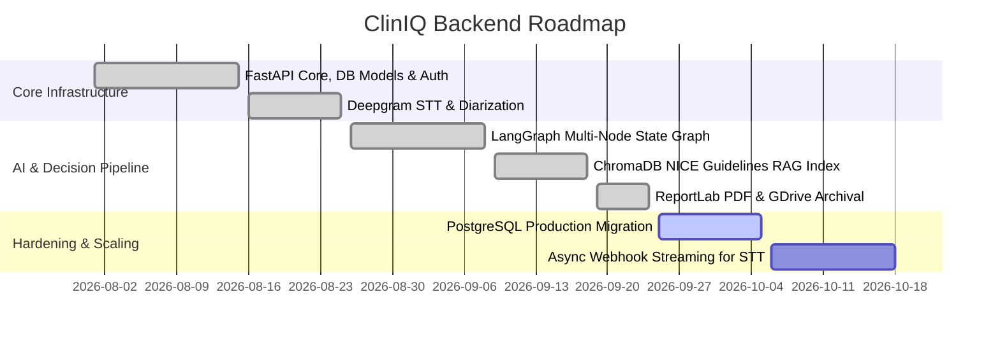

# Backend Tasks & Development Roadmap
## ClinIQ: Backend Clinical Intelligence Tasks

---

## 1. Development Milestones

---

## 2. Detailed Task Breakdown

### 2.1 Completed Tasks (Done)
- [x] **TSK-BE-01:** Scaffold FastAPI microservice with lifespan event handling (`app/main.py`).
- [x] **TSK-BE-02:** Implement SQLAlchemy ORM models with dual PostgreSQL / SQLite engine support (`app/core/database.py`).
- [x] **TSK-BE-03:** Build Gmail SMTP OTP generation, hashing, and verification service (`app/services/auth_service.py`, `app/services/email_service.py`).
- [x] **TSK-BE-04:** Integrate Deepgram Nova-2 Medical Speech-to-Text with speaker diarization mapping (`app/services/deepgram_service.py`).
- [x] **TSK-BE-05:** Implement LangGraph stateful clinical decision graph (`app/graph/clinical_graph.py`).
- [x] **TSK-BE-06:** Implement ChromaDB vector store ingestion and retrieval service over NICE clinical guidelines (`app/rag/`).
- [x] **TSK-BE-07:** Implement ReportLab PDF clinical report engine generating Clinical Analysis and SOAP note PDFs (`app/services/report_service.py`).
- [x] **TSK-BE-08:** Integrate Google Drive API via Service Account for automated cloud archival (`app/services/gdrive_service.py`).
- [x] **TSK-BE-09:** Build appointment scheduling endpoints with doctor slot management and booking validations (`app/api/scheduling.py`).
- [x] **TSK-BE-10:** Configure LangSmith tracing integration for LLM telemetry and observability (`app/core/tracing.py`).

### 2.2 Active Sprint Tasks (In Progress)
- [ ] **TSK-BE-11:** Add Redis-based caching layer for guideline vector query results to reduce repeated ChromaDB lookups.
- [ ] **TSK-BE-12:** Optimize ReportLab canvas styling to include hospital logo branding and QR codes linking to patient portal summaries.
- [ ] **TSK-BE-13:** Enhance prompt safety filters to prevent prompt injection from malicious patient transcripts.

### 2.3 Future Roadmap (Backlog)
- [ ] **TSK-BE-14:** Implement live WebSocket streaming endpoint (`/ws/audio`) for sub-second audio transcription streaming.
- [ ] **TSK-BE-15:** Add FHIR (Fast Healthcare Interoperability Resources) JSON export format for EHR/EMR compatibility (Epic/Cerner).
- [ ] **TSK-BE-16:** Support batch ingestion of custom hospital clinical guidelines in PDF/DOCX formats.

---

## 3. Maintenance & Testing Checklist

- [ ] Run `pytest` on authentication, OTP generation, and scheduling route tests.
- [ ] Test Google Drive service account token refresh resilience on expired credentials.
- [ ] Verify LangSmith tracing correctly tags prompt versions and latency metrics.
